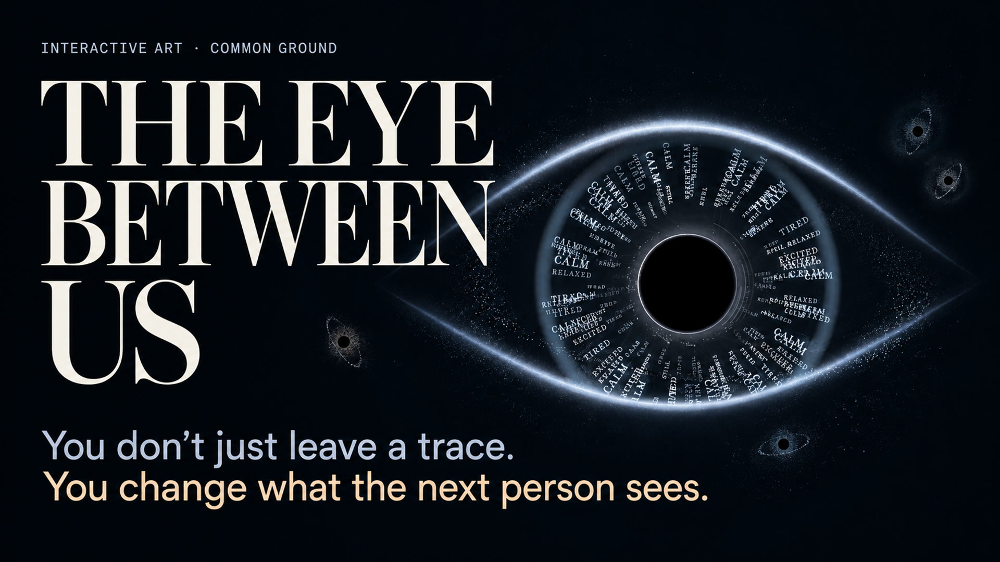

# The Eye Between Us — Live

**You don’t just leave a trace. You change what the next person sees.**

An interactive generative artwork where strangers shape a shared digital eye. The work remembers influence, not identity.



[Project poster](docs/pitch-poster.pdf)

## Experience

- Start with mouse gaze; click the artwork (or B) for a soft blink.
- Choose **Enable camera** to grant webcam access. Face landmarks drive gaze and blink detection. A local expression model supplies poetic iris words when available; movement-based interpretation remains available if it fails.
- **Mouse mode** stops webcam tracks and returns to pointer input.
- **Leave your trace** creates a small individual eye, sends an influence stream into the main eye, updates the word pool and increases particle density. A transition lock prevents duplicate commits.
- Memory is saved in this browser's localStorage; it is not shared across devices. The latest 48 individual imprints are visible, with up to 240 encounter records retained.
- **Reset memory** clears this browser's collective state after confirmation.
- Optional generative sound and fullscreen controls are available. D opens operator controls.

## Run

Use Node.js 22 or later and pnpm 11. The local experience requires no API key.

```sh
pnpm install
pnpm dev
pnpm test
pnpm build
pnpm preview
```

Camera access requires HTTPS or localhost and browser permission. Models and WASM are served from this project. Video frames are processed locally, never uploaded or stored. This published version selects the local interpreter by default; no API key is needed. Emotion words are artistic interpretations, not diagnoses or reliable claims about a person's inner state.

## Implementation

The live artwork uses procedural Canvas rendering with layered particles, text fibers, optical depth cues and smoothed gaze. It is not a prerecorded image, and does not reproduce every volumetric effect of the imagegen concept. Key files:

- `src/app/App.ts`: interaction orchestration, mode switch, memory and trace transitions.
- `src/visual/lidRibbons.ts`: continuous symmetric gradient eyelids, a depth-sorted orbital particle annulus, and blink shape.
- `src/visual/textIris.ts`: radial word chains and dissolution into the pupil.
- `src/visual/satellites.ts`: miniature galactic nuclei with a circular iris, dark pupil and tilted particle ring, without eyelids.
- `src/tracking`: local camera, landmark and expression inference.
- `src/visual/palette.ts`: color and quality controls.

Validation: TypeScript and production build pass, along with 68 unit tests covering camera lifecycle, interaction state, collective memory, Top 3 persistence, orbital clearance and one-by-one imprint growth. Browser and hardware-specific gaze accuracy varies.

## Emotion color direction

`src/visual/emotionPalette.ts` maps each keyword to a stable, subdued color. Joy/excitement use ivory and pale champagne; calm/serenity use mist blue; tension uses gray violet; sadness uses cool blue violet; neutral/still use silver gray. These are artistic assignments. Hero words use the same mapping. Satellite accents inherit their encounter’s dominant keyword.

## Core line

You don’t just leave a trace. You change what the next person sees.

The artwork remembers influence, not identity. Each encounter changes the collective visual state inherited by the next visitor.

## Personal imprints

Add your imprint opens a short note and feeling prompt. Notes are saved only in this browser and can be read by clicking their orbiting galaxy. Each galaxy has a seeded size, rotation and orbital pace; nearby bodies softly separate and glow on contact. Old records remain compatible.

## Single-origin sequence

A fresh installation begins with one origin galaxy, separate from the participant count. Each explicit Leave your trace or Create my imprint adds exactly one participant galaxy. Waiting, gaze and departure no longer automatically create records. Reset returns to one origin galaxy. Orbits adapt to the viewport and stay outside the main eye, expanding sideways on landscape screens. Gentle collisions preserve clearance from the central artwork.

This version uses `eye-between-us/v2-single-origin` storage; the previous `eye-between-us/v1` data remains untouched.


Satellite imprints retain the three strongest words at commit time. Words are hidden on the orbiting galaxy; clicking an imprint opens its three colored words and stored note. Prompt mode uses the selected feeling plus its two nearest poetic neighbours, rather than claiming camera inference. Older records retain only the words actually saved (up to three). The iris and star ring have transparent backgrounds; only the small central pupil remains black.

Responsive satellite orbits now derive their clearance from the main eye, expanding sideways on landscape screens. Collision displacement is constrained outside that envelope. A fresh or reset memory starts with one origin galaxy; each explicit trace adds one participant imprint. Existing saved traces remain on reload.
